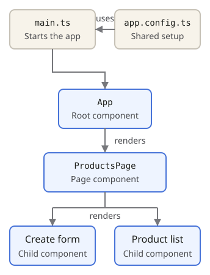

## Build the screen from components

- **Component:** a TypeScript class paired with a template; **owns a piece of UI**.
  Split components when those pieces need their own behavior or can be reused.
- **Template:** HTML with Angular bindings for **displaying state and responding
  to events**.
- **Root component:** the **first component Angular renders**, usually `App`.
  Use it to compose the application's outer layout. “Page” and “child” are
  **roles, not special component types**.
- **Application configuration (`app.config.ts`):** shared setup, such as routing,
  HTTP interceptors or the default error handler. Configure it when the **same
  behavior should apply across the app**.

`main.ts` selects the root component and configuration when starting Angular.

## Reuse behavior through services and DI

Components, services and interceptors can use **`inject(...)` to request
dependencies**; Angular supplies instances using their providers.

Angular supplies some built-in dependencies automatically. Others become
available when you configure a feature, so **not every injected dependency
needs your own `providers` entry**.

- **Service:** a class containing behavior that can be used **independently of a
  particular template**. Put product API calls here so components can use them
  without each repeating the HTTP code.
- **Dependency injection (DI):** **Angular supplies a class's dependencies** instead
  of the class constructing them. This lets components share a service and lets
  tests substitute a fake implementation.
- **Provider:** a registration telling Angular **what to supply** for a requested
  dependency.
- **Provider scope:** determines **where the dependency is available and which
  consumers share it**. Register application-wide services with `providedIn: 'root'`
  or application configuration; use route, component or directive providers for
  narrower scopes. Module-based apps also support module providers.
- **Injector:** Angular's dependency resolver. It **looks up providers and supplies
  the dependencies**.

## Apply shared HTTP behavior

**Interceptor:** a function in Angular's **HTTP request/response pipeline**. Use one
when several API calls need the **same authentication header or request logging**,
so each service method does not repeat that behavior. A basic product lookup needs no custom interceptor.
