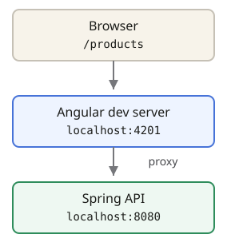

## Local request path



## Configure and run

Create **`ui/src/proxy.conf.json`**:

```json
{
  "/products/**": {
    "target": "http://localhost:8080"
  }
}
```

From **`ui/`**:

```bash
npm start -- --port 4201 --proxy-config src/proxy.conf.json
```

| Request path in frontend code | Forwarded destination                 |
| ----------------------------- | ------------------------------------- |
| `/products`                   | `http://localhost:8080/products`      |
| `/products/UUID`              | `http://localhost:8080/products/UUID` |

With the current `@angular/build:dev-server`, `/products/**` matches the base
path **and nested paths**. No path rewrite is needed for this API.

## Avoid these traps

- Use **relative URLs** in frontend code. Calling `http://localhost:8080`
  directly bypasses the proxy and requires the API's CORS configuration.
- Run Spring Boot separately; the proxy **does not start the API**.
- **Restart `ng serve` after changing proxy configuration.**
- This is **development-server configuration**. A production host needs its own
  reverse proxy/routing, or an explicit API origin with appropriate CORS.
