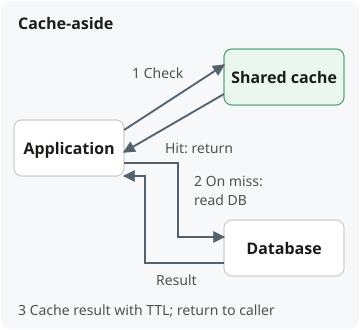
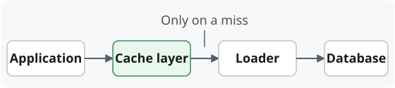
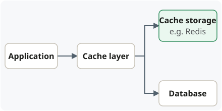
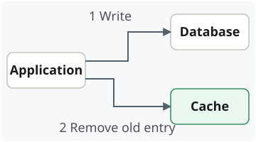

## Read strategies

**Key distinction: who owns the orchestration?**

- **Cache-aside:** **application code** checks the cache, loads missing data, and
  stores the result. **More control**, more orchestration code.
- **Read-through:** the **cache layer** coordinates those steps, calling your
  **loader** to fetch missing data. **Simpler callers**—they just request a value.

### Cache-aside

### Read-through

**Loader:** the same **data-fetching code** you would use on a cache-aside miss,
such as a **Spring service/repository method**—called by the cache layer instead.
It fetches the data; the **cache layer handles checking, storing, and returning**.

### With Spring + Redis

- **Spring/application:** checks the cache, loads missing data, and decides when to
  add or invalidate entries.
- **Redis:** stores values and executes cache commands; handles **TTL expiration**
  and **memory-based eviction** according to configuration.

> Redis does **not automatically detect PostgreSQL changes** or **reload missing
> data**.

## Write strategies

### Write-through

**The cache layer normally updates both before returning success.** Branches show
destinations, **not necessarily parallel execution**. Adds write latency. If only
one update succeeds, decide whether to **fail the request**, **retry**, or **accept
temporary inconsistency**. Failing the request does not automatically undo the
update that succeeded.

### Write-behind

**Success before the database write completes.** Lower write latency, but requires
**durable pending writes**, **ordering/version checks**, and **safe retries**.

### Write to source, invalidate cache

**Next cache miss reloads from the database.**

- **Useful for derived results:** a product update may affect cached search results
  or category summaries. Removing affected entries can be simpler than rebuilding
  them immediately.
- **Tradeoff:** **simpler writes**, but a later read must reload the data. Entries
  nobody reads again are not rebuilt.

**Concurrent reads** can still refill **old data**; invalidation alone does not
ensure strict freshness.

> Read and write strategies are **separate choices**. Read-through **does not imply
> write-through**.

## Cache keys

**Cache keys identify which result to reuse.**

- **Example:** `product:123` identifies cached details for product 123.
- **Include what changes the result:** if those details differ by **tenant** or
  **language**, include that in the key.
- **Tradeoff:** too few distinctions can return the **wrong data**; unnecessary
  distinctions create duplicate entries and **reduce cache hits**.
