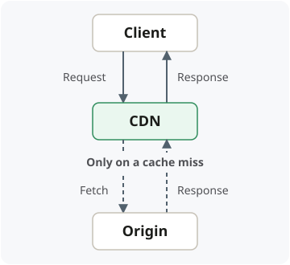

## Hits and misses

**On a miss:** the CDN fetches and serves the response. Whether it caches that
response—and for how long—depends on **origin response headers and CDN
configuration**.

**Simultaneous misses:** some providers can combine requests into **one fetch**;
behavior depends on configuration.

## Freshness controls

- **Long TTL:** more **cache hits**; changes appear later.
- **Short TTL:** more **origin checks and load**.
- **Revalidation:** ask the origin whether content **changed**.
- **Purge / invalidation:** remove content **before expiration**.
- **Versioned URLs:** new content uses a **new URL**.

**TTL** is the freshness lifetime, controlled by **HTTP cache headers** and CDN
configuration. **Versioned URLs** suit assets that never change at the same URL.

> **Expiration ≠ deletion:** an expired response may be revalidated. Content can
> also be **evicted before expiration**. Policies may allow **stale responses**
> during revalidation or origin failure.

Provider details: [CloudFront freshness controls](https://docs.aws.amazon.com/AmazonCloudFront/latest/DeveloperGuide/Expiration.html)
and [origin requests](https://docs.aws.amazon.com/AmazonCloudFront/latest/DeveloperGuide/RequestAndResponseBehaviorCustomOrigin.html).
