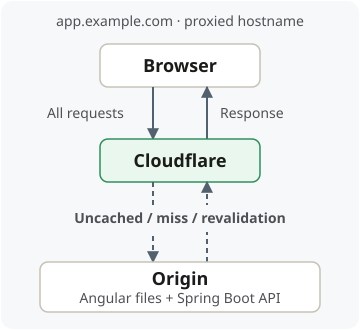

## Where the CDN sits

**Example:** `app.example.com` serves **Angular files** and routes `/api/*` to
**Spring Boot**.



> **Passing through ≠ being cached.** Even requests that are **never cached** pass
> through the CDN when their hostname is proxied. A **fresh hit** needs no origin
> request.

## Setup and caching rules

1. **DNS:** configure `app.example.com` as **proxied** in Cloudflare, pointing to
   your origin; enable **HTTPS at the origin with a valid TLS certificate** and
   select **Full (strict)** in Cloudflare.
2. **Angular:** keep the **same URLs**. A separate asset hostname is optional.
3. **CDN dashboard → Cache Rules:** choose which paths are **eligible** or
   **bypass** caching; set TTL and whether to **respect origin headers**.

**Example starting policy:**

| Content              | CDN policy |
| -------------------- | ---------- |
| **Versioned files**  | Long TTL   |
| **HTML / UI routes** | Bypass     |
| **`/api/*`**         | Bypass     |

**Origin headers:** set on the server serving the response—static host/Nginx for
Angular files; **Spring Boot** for API responses.

For versioned files such as `main-ABC.js` whose contents never change at that URL:

```http
Cache-Control: public, max-age=31536000, immutable
```

**CDN rules and response headers both matter.** A header alone does not guarantee
CDN caching; rules can override it. Browser caching is separate from CDN caching.

## When enabling API caching

**Public endpoint example:** `/api/products?page=1` versus `?page=2`.

- **Cache key:** the CDN's lookup identifier, usually based on the **URL**.
- **Include `page`:** these requests need **different entries**; ignoring it can
  return the **wrong product page**.
- **Personalized/private responses:** leave uncached unless sharing is explicitly
  safe. Headers and cookies can also change a response.

Configuration: [Cloudflare proxy setup](https://developers.cloudflare.com/dns/proxy-status/),
[Cache Rules](https://developers.cloudflare.com/cache/how-to/cache-rules/settings/),
[cache keys](https://developers.cloudflare.com/cache/how-to/cache-keys/),
and [Spring response headers](https://docs.spring.io/spring-framework/reference/web/webmvc/mvc-caching.html).
