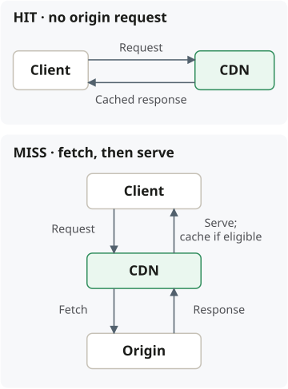

## When to use a CDN

Serve **repeated, cacheable content near geographically distributed users** to
reduce delivery latency and origin load. Common workloads: images, JavaScript,
CSS, downloads, and video.

CDNs can also accelerate uncached traffic. DDoS protection, WAF, routing,
image optimization, and edge compute depend on the provider and plan.

## Benefits and tradeoffs

| Benefit                                   | Cost or constraint                                                                          |
| ----------------------------------------- | ------------------------------------------------------------------------------------------- |
| Lower latency through edge delivery       | Misses still incur upstream latency; the physically closest edge is not necessarily fastest |
| Fewer origin requests                     | Savings depend on cacheability and reuse                                                    |
| Absorbs bursts for popular cached content | Cold caches and miss bursts can still overload the origin                                   |
| Reuses responses                          | Freshness and cache-key rules need explicit decisions                                       |
| Distributed delivery infrastructure       | A sole provider or shared configuration remains an availability dependency                  |

**Common choices:** Cloudflare, Akamai, Amazon CloudFront.

Compare coverage, cache controls, origin integration, and required security
features. Cost may depend on **bytes delivered, requests, regions, and extras**, or
use a subscription or negotiated contract. Check current
[CloudFront pricing](https://aws.amazon.com/cloudfront/pricing/) and
[Cloudflare plans](https://www.cloudflare.com/plans/).

## Population and cache misses

Content is typically populated **on demand**. On a miss, the CDN fetches from an
upstream cache or origin, forwards the response, and stores it **if cacheable**.
The client normally continues talking to the CDN.

Eligible simultaneous misses may be combined into one upstream fetch; this is
provider- and configuration-dependent.

## Freshness and safe sharing

| Mechanism            | Decision consequence                                                              |
| -------------------- | --------------------------------------------------------------------------------- |
| Long TTL             | More cache hits; changes may take longer to appear                                |
| Short TTL            | More frequent origin checks and greater origin load                               |
| Revalidation         | An expired response can become fresh again if the origin confirms it is unchanged |
| Purge / invalidation | Removes cached content before normal expiration                                   |
| Versioned URLs       | Changed content gets a new identity; useful for immutable assets                  |

TTL and HTTP cache headers control freshness. **Expiration is not deletion**;
objects may also be evicted before expiration. Configured policies may permit
serving stale content during revalidation or origin failure.

> Requests sharing a cache entry must be safe to share. Account for relevant query
> parameters, headers, cookies, and personalization in cache-key and response rules.

## Origin access and outages

Some origins accept requests **only from the CDN**, preventing clients from
bypassing access or security controls.

**Direct-origin fallback is optional:** the origin needs permission to accept those
requests and capacity for the extra traffic. Choose controlled fallback, another
CDN, or graceful degradation according to availability and security requirements.

For exact behavior, see [cache expiration](https://docs.aws.amazon.com/AmazonCloudFront/latest/DeveloperGuide/Expiration.html),
[origin requests](https://docs.aws.amazon.com/AmazonCloudFront/latest/DeveloperGuide/RequestAndResponseBehaviorCustomOrigin.html),
and [restricted origin access](https://docs.aws.amazon.com/AmazonCloudFront/latest/DeveloperGuide/private-content-restricting-access-to-s3.html).
