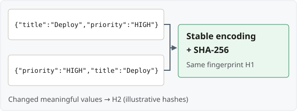

## Identify the caller and request

### Caller scope — who may share a result?

Use the **authenticated tenant/account, user or API client** whose requests may
share the saved result.

### Operation — which action?

Use a **stable ID** such as `create-ticket:v1`. Include a relevant target/version,
e.g. `update-ticket:42:v1`.

### Key — which intended operation?

Read `Idempotency-Key`; **validate its length and format**.

### Fingerprint — same request data?

Compute a **server-side hash** of stable, meaningful request inputs.

**Look up:** caller scope + operation + key. **Compare:** fingerprint.

> **Authorize originals and replays.** IP and browser `Origin` are not reliable
> caller identities; a key does not grant access to a saved result.

**JWT example:** map the validated issuer + subject (`sub`) to your tenant/account.
Spring JWT resource servers normally use `sub` for `Authentication.getName()`.

## Build a stable fingerprint

- **Include:** validated business payload and relevant path/query values.
- **Normalize:** defaults and object-property order; formatting must not cause
  accidental mismatches. Use ordered DTO encoding or a scheme such as JCS.
- **Preserve meaningful array order.** Ignore transport-only values such as trace IDs.

`H1` and `H2` stand for hashes. With the **same scoped key**, a matching fingerprint
permits replay of a completed result; a different fingerprint means **reject**.

## Sources

- [Spring Security: validated JWT identity](https://docs.spring.io/spring-security/reference/servlet/oauth2/resource-server/jwt.html)
- [JSON canonicalization (JCS)](https://www.rfc-editor.org/rfc/rfc8785.html)
- [AWS: caller scope and request intent](https://aws.amazon.com/builders-library/making-retries-safe-with-idempotent-APIs/)
