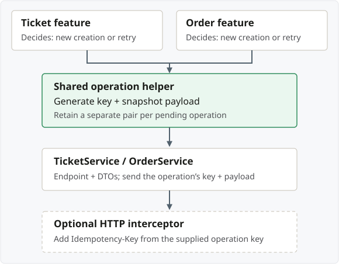

## Send the header and show the retry path

**New creation:** capture a new key + submitted data. **Retry:** reuse that
pending operation.

```typescript
// First valid submit: create once per intended operation.
const pending = {
  key: crypto.randomUUID(),
  payload: { title: formValue.title },
};

// Every attempt uses the same pending key and payload.
const send = () =>
  http.post<Ticket>('/api/tickets', pending.payload, {
    headers: { 'Idempotency-Key': pending.key },
    observe: 'response',
  });

function attempt() {
  send().subscribe({
    next: (response) => {
      /* show result; finish this operation */
    },
    error: (error) => {
      /* show error; retain pending if outcome is unknown */
    },
  });
}

attempt(); // First request.

// Called later by the Retry button after a retryable failure.
function retryPending() {
  attempt(); // Another request, with the same key and payload.
}
```

Component-logic excerpt: `HttpClient`, `Ticket` and form values are assumed.
Template, UI state and error classification are omitted. Wire the Retry button
to `retryPending()`; suppress overlapping attempts and finish the pending
operation on confirmed success.

Each subscription sends a request. **Do not regenerate the key or reread edited
form data inside the retry path.**

| Placement/name                                   | Use                                                                     |
| ------------------------------------------------ | ----------------------------------------------------------------------- |
| `Idempotency-Key` header                         | Recognizable convention; used by Stripe                                 |
| API-specific header, such as `PayPal-Request-Id` | Follow that API's contract; HTTP header names are case-insensitive      |
| Body field, such as `clientToken`                | Also valid when the API defines it; not interchangeable with its header |

> **Frontend and API on different origins?** Configure the API's CORS rules to
> **allow sending `Idempotency-Key`**. If frontend code reads `Location`, also
> **expose that response header**. Angular's `observe: 'response'` provides access
> only to headers the browser permits.

## Generate, reuse or replace?

| Event                                    | Key + submitted data                                                               |
| ---------------------------------------- | ---------------------------------------------------------------------------------- |
| First valid submit                       | **New key** + payload snapshot                                                     |
| Retry / outcome unknown                  | **Reuse key + snapshot**                                                           |
| Form edited before save outcome is known | **Keep original key + payload** for retries; editing alone starts no new operation |
| Confirmed success                        | **Clear the pending key + payload**                                                |
| **Validation failed; nothing created**   | Correct input; use a **new key** for the corrected submission                      |
| New intended creation                    | **New key**, even for identical values                                             |
| Reload/navigation                        | **Persist key + payload** if recovery is needed                                    |

- **While sending:** suppress duplicate submissions.
- **Edited form:** don't overwrite the unresolved operation's saved payload.

A `500` or client cancellation does not prove that creation failed. Follow the
API's failure/replay contract; do not blindly rotate keys or clear state in
`finalize()`. Persist only the pending data the application can safely retain.

## Which value?

### Default: random UUID v4

```typescript
const key = crypto.randomUUID();
```

Generate once per intended creation; **reuse for retries**.

**`crypto.randomUUID()` requires HTTPS, or localhost for local development.**

### Other choices

- **Stable operation ID:** useful if the operation already has a durable
  identity. Namespace it; distinguish a new operation with a new ID or version.
- **Avoid a payload hash alone:** identical data can represent **two separate
  creations**.

Use **opaque values**, not personal data. Follow the API's length and format
rules. Keys identify operations; they are **not authentication credentials**.

## What can be shared?



- **New creation:** the feature asks the helper for a new key + payload snapshot.
- **Retry:** the feature reuses that saved pair.
- **Header handling:** set it in the API service, or opt into an interceptor
  using `HttpContext`.

> **Share the code; keep state per operation.** A ticket and an order must not
> accidentally reuse one application-wide “current key”.

**Do not generate a new key in the interceptor for each attempt.** It cannot
know whether a request is a retry or a different intended creation.

The operation helper is application code, not a built-in Angular idempotency
service.

## Sources

- [Angular: HTTP interceptors and HttpContext](https://angular.dev/guide/http/interceptors)
- [Angular: HttpClient requests, headers and retry subscriptions](https://angular.dev/guide/http/making-requests)
- [Stripe: key values and parameter comparison](https://docs.stripe.com/api/idempotent_requests)
- [PayPal: PayPal-Request-Id](https://developer.paypal.com/api/rest/reference/idempotency/)
- [AWS EC2: client tokens](https://docs.aws.amazon.com/ec2/latest/devguide/ec2-api-idempotency.html)
- [Web Crypto: randomUUID](https://w3c.github.io/webcrypto/#Crypto-method-randomUUID)
- [Fetch: CORS protocol](https://fetch.spec.whatwg.org/#http-cors-protocol)
