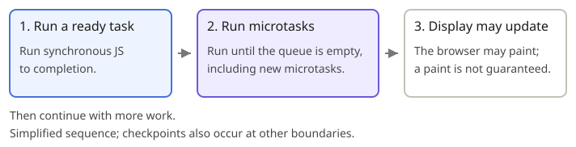

The **event loop** is the host's scheduling mechanism: it coordinates **when ready tasks run** and **when microtasks are drained**.

## The order to remember



## Callback, task, or microtask?

- **Callback:** **the function** passed to another API.
- **Task:** **host-scheduled work**, such as dispatching a user interaction or invoking a timer callback.
- **Microtask:** work placed in a **separate queue**, such as invoking a Promise handler. It runs **after current synchronous execution finishes, before another task starts**.

A **timer callback** is the function passed to `setTimeout` or `setInterval`—not the registration call itself.

## What is a microtask checkpoint?

A checkpoint is **when the browser drains the microtask queue**. In the ordinary script/callback examples here, this happens after current synchronous execution finishes and the JS stack is empty.

- Microtasks run in **enqueue order**.
- Microtasks added while draining **run in the same checkpoint**.
- Draining stops **only when the queue is empty**. Continually adding microtasks can **delay other tasks and rendering**.

Checkpoints also occur at other specified boundaries; they are **not limited to one checkpoint per task**.

## Common microtask sources

- **Promise handlers:** `.then()`, `.catch()`, and `.finally()`, once the relevant Promise settles.
- **After `await`:** resuming the async function when the awaited outcome is ready—even if it was already ready.
- **`queueMicrotask(callback)`:** explicitly queues a callback.
- **`MutationObserver`:** delivery of mutation notifications to observer callbacks.

```js
console.log('start');
setTimeout(() => console.log('timer'), 0);
Promise.resolve().then(() => console.log('promise'));
console.log('end');
// start → end → promise → timer
```

## `await` or `.then()`: which runs first?

**Compare when their microtasks are queued.** Run each case separately with this
setup, using an **already fulfilled native Promise**:

```js
const ready = Promise.resolve();

async function somefun() {
  console.log(1);
  await ready;
  console.log('a');
}
```

**Reach `await` first → queue `[a, b]`:**

```js
somefun();
ready.then(() => console.log('b'));
// 1 → a → b
```

**Register `.then()` first → queue `[b, a]`:**

```js
ready.then(() => console.log('b'));
somefun();
// 1 → b → a
```

**`1` prints synchronously in both cases.** Calling `.then()` queues its callback;
it does not run it inline. Both `a` and `b` wait until current synchronous execution
finishes. A pending awaited Promise must settle before its continuation is queued.

To require `b` after `a`, attach the handler to **the function's returned Promise**:
`somefun().then(() => console.log('b'))`.

## Tasks do not share one global FIFO

Browsers have multiple task sources and task queues. There is no single global FIFO
ordering every timer, network event, and click.

**Registration order alone does not guarantee execution order across different task sources.**
