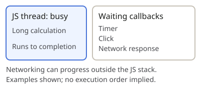

> Calling an ordinary function **starts its body immediately**.
>
> Passing a function as a callback **does not call it**. The receiving API determines when it runs.

## Calls and callbacks

A **callback** is a function passed elsewhere to be called. The word says nothing about timing.

| Code                    | When does `foo` run?                                        |
| ----------------------- | ----------------------------------------------------------- |
| `foo()`                 | **Immediately**                                             |
| `[1, 2].map(foo)`       | **Synchronously**, during `map`                             |
| `setTimeout(foo, 100)`  | **Later**, when eligible and execution can proceed          |
| `setInterval(foo, 100)` | **Repeatedly**, as timer callbacks get opportunities to run |

## Call stack: active calls

The call stack records **active calls**. Calling a function adds a **frame**; returning removes it and resumes the caller.

## Browser host: waiting and readiness

The browser supplies **timers, networking, and DOM events**.

Calling `setTimeout` or `setInterval` **registers future work** with the host. After registration returns, **the script continues**.

```js
console.log('start');
setTimeout(() => console.log('timer'), 100);
console.log('continue');
// start → continue → timer
```

The host manages the wait, then makes the callback eligible to execute. **Eligible does not mean running:** execution can be delayed by other work.

> A timer is bookkeeping for a future callback—not a function sleeping on the call stack.
>
> **The registration call runs now; the callback runs later.**

## One thread: run to completion

Ordinary page JavaScript runs on the **browser's main thread**. Workers have **separate execution threads**.

**A queued task cannot interrupt JavaScript already executing on that thread.** The current execution runs to completion before another task begins.


