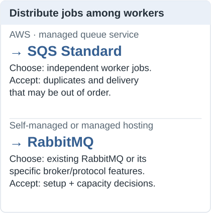
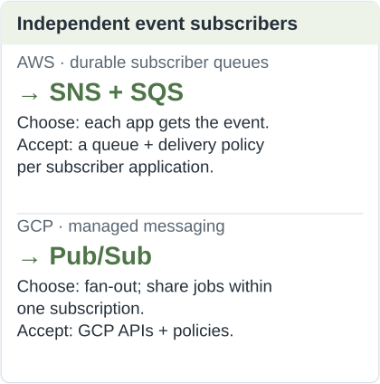
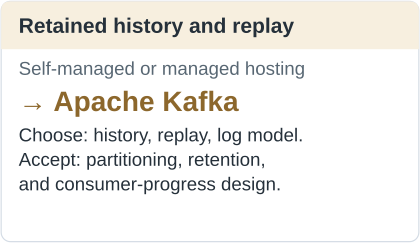

> **Thumbnail jobs:** compare **SQS Standard** and **RabbitMQ** first; **Pub/Sub** is a GCP option. Retained-history or replay requirements give Kafka a stronger reason.

**Broker setup ≠ self-managed hosting.** Defining queues, routing rules, and retries also applies to a hosted broker. Self-management adds servers, upgrades, availability, and recovery.

These are starting points, not exclusive capabilities. Standard is an SQS queue type; ordering requirements may lead to FIFO. Managed hosting reduces infrastructure work, not application delivery responsibilities.

## Sources

- [SQS Standard](https://docs.aws.amazon.com/AWSSimpleQueueService/latest/SQSDeveloperGuide/standard-queues.html) and [FIFO delivery](https://docs.aws.amazon.com/AWSSimpleQueueService/latest/SQSDeveloperGuide/FIFO-queues-understanding-logic.html)
- [RabbitMQ queues](https://www.rabbitmq.com/docs/queues) and [managed RabbitMQ on Amazon MQ](https://docs.aws.amazon.com/amazon-mq/latest/developer-guide/welcome.html)
- [SNS + SQS fan-out](https://docs.aws.amazon.com/sns/latest/dg/sns-sqs-as-subscriber.html)
- [Google Pub/Sub versus managed Kafka](https://docs.cloud.google.com/pubsub/docs/choose-pubsub-kafka)
