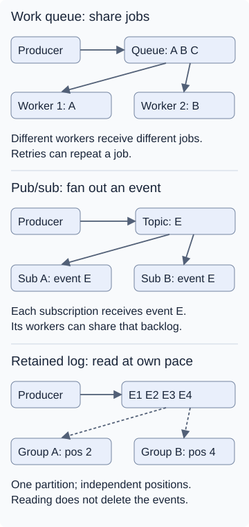

## Choose from the requirement

### Work queue

Distribute thumbnail jobs among workers.

**Tradeoff:** Retries can repeat work; effects must tolerate duplicates.

### Publish/subscribe

Let billing, email, and analytics each react to an order event.

**Tradeoff:** Each subscription needs its own backlog and failure policy.

### Event stream/log

Retain events for replay or process an ordered sequence.

**Tradeoff:** Manage retention and consumer positions; ordering has a defined boundary.

## How delivery differs

## Before choosing

- **Pub/sub can be durable:** offline consumers do not automatically lose messages. Retention and subscription settings matter.
- **Streams do not require multiple consumers:** retention, replay, and ordered event processing are stronger selection reasons. Ordering is commonly per partition, not global.
- **Products overlap:** queues, pub/sub, and logs are models, not mutually exclusive product categories.

A **producer** sends messages; a **consumer** processes them; a **broker** is infrastructure that routes or stores them. A **topic** names a publication destination; its delivery semantics depend on the product.

> **Database jobs can also fit.** A durable job table avoids another service, but workers need safe claiming, retries, and recovery; polling adds database load.

## Sources

- [RabbitMQ consumers](https://www.rabbitmq.com/docs/consumers)
- [Google Pub/Sub subscriptions](https://docs.cloud.google.com/pubsub/docs/subscription-overview)
- [Kafka design](https://kafka.apache.org/design/)
