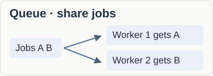
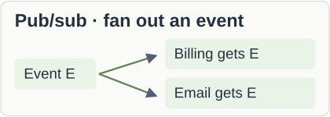
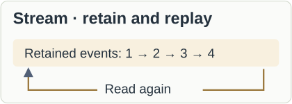

- **Use:** distribute thumbnail jobs among workers.
- **Plan for:** retries can repeat work; make effects duplicate-safe.

- **Use:** let independent applications each react to the same event.
- **Remember:** durable subscriptions or subscriber queues can retain messages while consumers are offline.

- **Use:** retained history, replay, or ordered event processing.
- **Plan for:** retention limits replay; ordering is commonly per partition, not global. Multiple consumers are optional.

> **Database jobs can also fit.** A durable job table avoids another service, but workers need safe claiming, retries, and recovery; polling adds database load.

## Terms and boundaries

- **Producer / consumer:** sends / processes messages.
- **Broker:** infrastructure that routes or stores messages.
- **Topic:** named publication destination; delivery semantics depend on the product.
- **Models overlap:** one product can support queues, pub/sub, and logs.

## Sources

- [RabbitMQ consumers](https://www.rabbitmq.com/docs/consumers)
- [Google Pub/Sub subscriptions](https://docs.cloud.google.com/pubsub/docs/subscription-overview)
- [Kafka design](https://kafka.apache.org/design/)
