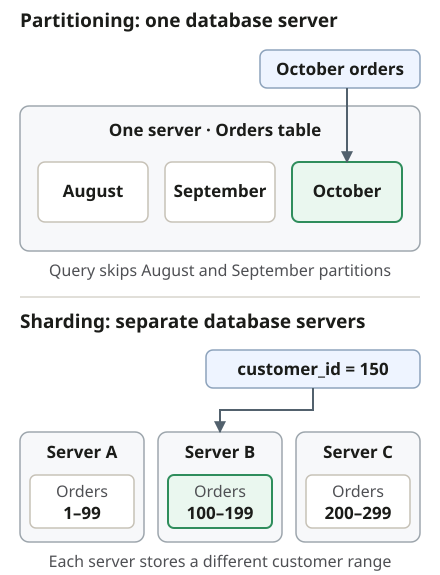

## Start with the bottleneck

| Pressure          | Options              |
| ----------------- | -------------------- |
| **Slow queries**  | Queries / indexes    |
| **Read volume**   | Replicas / cache     |
| **Node capacity** | Vertical scaling     |
| **Write volume**  | Tune / scale / shard |

Inspect **query plans**, **connection pools**, and **contention** before adding infrastructure.

## Know the limits

- **Vertical scaling:** more CPU, memory, or faster storage; bounded by **capacity and cost**.
- **Read replicas:** asynchronous replication can **lag**; primary writes still go to the **primary**.
- **Caching:** helps repeated reads, at the cost of **freshness and invalidation** decisions.
- **Sharding:** requires locating the correct shard, handling **hot keys**, and coordinating **cross-shard joins/transactions**.

## Partitioning versus sharding

**Table partitioning** splits a table into parts **within a database**. It can let queries **skip irrelevant partitions** and simplify maintenance, **without necessarily spreading writes across database nodes**.

**Sharding** distributes data **across database nodes**. Choose a key that **spreads
load** and keeps important operations together where possible.

## Availability is a separate concern

**Standby replicas** support failover but may not serve application reads.
**Readable replicas** can also add read capacity. A **read immediately after a write** may require the
**primary** or another explicit consistency mechanism.

See [RDS read replicas](https://docs.aws.amazon.com/AmazonRDS/latest/UserGuide/USER_ReadRepl.html)
and [PostgreSQL partitioning](https://www.postgresql.org/docs/current/ddl-partitioning.html).
