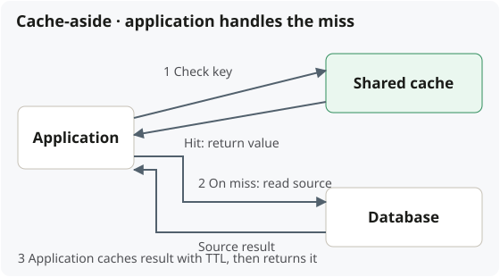

## When to use a shared cache

Reuse **expensive, repeated reads across application instances**. Common uses:
product details, computed results, and frequently read reference data.

### Shared cache

**Use when:** Multiple application instances should reuse the same cached results.

- **Benefit:** Less duplicate loading and storage.
- **Cost:** Network round trip and a shared operational dependency.

### Per-instance local cache

**Use when:** Fast access within each instance matters most.

- **Benefit:** No network hop or remote-cache dependency.
- **Cost:** Separate warm-ups, duplicated data, and harder cross-instance invalidation.

Both can be combined, but every added cache layer needs a freshness policy.

## Benefits and costs

**Lower read latency and less database load** cost memory, operational effort,
and potentially stale data. Use the acceptable staleness to choose a TTL;
shorter TTLs increase refills, while longer TTLs can delay visible updates.

- **Miss bursts / cold start:** can overload the database. Consider request
  coalescing, prewarming, and staggered expiration.
- **Cache outage:** replicas and failover reduce single-node risk. Bound database
  fallback; it may not support the full uncached workload.
- **Correctness-sensitive decisions:** validate against authoritative state;
  cached availability is not an atomic reservation.

## Loading and write strategies

| Strategy      | Who handles the operation?                                                      |
| ------------- | ------------------------------------------------------------------------------- |
| Cache-aside   | Application checks the cache; on a miss, reads the source and caches the result |
| Read-through  | Cache abstraction invokes a configured loader on a miss                         |
| Write-through | Writes pass through a layer that updates the backing store and cache            |
| Write-behind  | Backing-store writes are deferred; adds loss, ordering, and retry concerns      |

Read strategy and write strategy are separate choices. A framework can hide
cache-aside orchestration from business code; the cache server need not query
the database itself.

## Invalidation, expiration, eviction

| Term         | Trigger                                 | Example                                        |
| ------------ | --------------------------------------- | ---------------------------------------------- |
| Invalidation | A cached value should no longer be used | Product changed: remove its old cached details |
| Expiration   | Configured lifetime elapsed             | A 30-second TTL runs out                       |
| Eviction     | Capacity / replacement policy           | Remove a less-used entry to make room          |

**An entry can be evicted before its TTL expires.** Some APIs also use “evict”
for explicit invalidation. Update and invalidation ordering matters: concurrent
misses can refill old data, so deletion alone does not guarantee strict freshness.

## Concrete choices

| Candidate          | Fit                                                                             |
| ------------------ | ------------------------------------------------------------------------------- |
| Redis / Valkey     | In-memory key-based access, TTLs, richer data structures, and atomic operations |
| Memcached          | Simpler disposable key/value caching                                            |
| Amazon ElastiCache | Managed AWS service; choose Valkey, Redis OSS, or Memcached as the engine       |
| Caffeine           | Java in-process cache when local reuse is sufficient                            |

For product details, a key such as `product:123` can hold a serialized result.
Include tenant, permissions, or other inputs in the key when they change the
answer. Redis does not automatically load PostgreSQL on a miss.

See [Redis eviction policies](https://redis.io/docs/latest/develop/reference/eviction/)
and [ElastiCache engine choices](https://docs.aws.amazon.com/AmazonElastiCache/latest/dg/SelectEngine.html).
