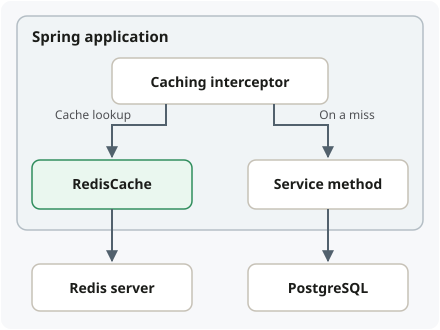
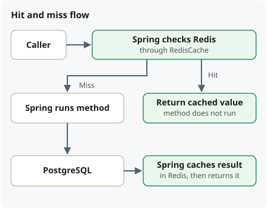

## Cache a method result

```java
@Cacheable(cacheNames = "products", key = "#p0")
public ProductDetails getProduct(long productId) {
    return repository.findDetailsById(productId);
}
```

Assumes a Spring-managed service, caching enabled with `@EnableCaching`, a
Redis-backed `CacheManager`, and configured Redis connectivity and value
serialization.

**Key example:** `#p0` selects the **value of the first argument**, without relying
on parameter names. For `getProduct(123L)`:

- **Spring cache key:** `123L`, in the `products` cache.
- **Default Redis key:** `products::123`—cache-name prefix plus the converted key.
  Custom prefix/key configuration can change this; it is not automatically
  `product123`.





## Configure a 30-second TTL and JSON values

In a caching configuration class:

```java
@Bean
RedisCacheManager cacheManager(RedisConnectionFactory factory) {
    return RedisCacheManager.builder(factory)
        .cacheDefaults(RedisCacheConfiguration.defaultCacheConfig()
            .entryTtl(Duration.ofSeconds(30))
            .serializeValuesWith(
                RedisSerializationContext.SerializationPair.fromSerializer(
                    RedisSerializer.json())))
        .build();
}
```

- **TTL:** these defaults apply to all caches managed here; configure individual
  caches separately when their freshness requirements differ.
- **Value format:** `defaultCacheConfig()` already uses Java serialization, which
  requires `ProductDetails` to be serializable. `serializeValuesWith(...)` switches
  the cached values to JSON; Redis cache keys still use the default string format.

## Traps

- **Self-invocation:** as with `@Transactional`, calling an annotated method from
  another method **on the same object** normally **bypasses the Spring proxy**, so
  `@Cacheable` does not take effect.
- **Writes:** `@Cacheable` does not invalidate results when the database changes;
  coordinate updates and invalidation with transaction completion.
- **Concurrent misses:** when a popular entry expires, multiple app instances may
  query PostgreSQL before Redis is refilled. `@Cacheable` alone does not guarantee
  a single database load.

See [Spring caching annotations](https://docs.spring.io/spring-framework/reference/integration/cache/annotations.html)
and [Spring Data Redis cache configuration](https://docs.spring.io/spring-data/redis/reference/redis/redis-cache.html).
