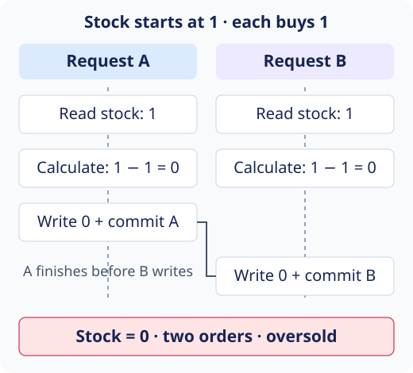

> **All-or-nothing does not mean one transaction at a time.** Atomicity groups
> changes; concurrency control protects decisions when transactions overlap.

## Why can both purchases succeed?



This **lost update** is possible at PostgreSQL's default **Read Committed**
isolation: both requests read `1`, calculate `0` in application code, then write
that literal `0`. Stronger isolation can reject this execution.

An unconditional `SET stock = stock - 1` is different: both decrements can apply,
leaving **−1** unless a constraint or other protection prevents it.

**PostgreSQL automatically locks rows it updates.** Competing writes to one row
wait for each other, but that does not protect an **earlier read/check**. No
explicit locking command does **not** mean no database locks.

## Choose protection for the stock rule

### Lock before checking

Read the stock row with `SELECT … FOR UPDATE`; check availability and update it
in the **same transaction**. Competing writers/locking reads wait until that
transaction ends; ordinary reads can still proceed.

**Cost:** contention and long transactions increase waiting; multiple locks can
introduce deadlocks.

### Atomic conditional update

Check sufficient stock **in the update itself**. Use the affected-row count or
returned row to decide whether the purchase may proceed.

**Cost:** callers must handle an unmet condition. Competing updates can still
wait on database locks; this is not lock-free.

### Version check

Include the **version originally read** in the update condition and increment
it atomically. A changed version rejects the stale write. Availability must
still be checked against the stock read.

**Cost:** conflicts require rollback and deliberate retry/rejection. A retry
must reread and revalidate; it is not permission to oversell. See **Optimistic
locking with @Version** for the JPA implementation.

## PostgreSQL: decrease only if stock remains

Inside the **same transaction as order and line-item creation**, for one unit
of product `42`:

```sql
UPDATE product_stock
SET stock = stock - 1
WHERE product_id = 42 AND stock >= 1
RETURNING stock;
```

Assume `product_id` uniquely identifies a stock row.

- **One returned row:** stock was decreased; commit only if all order/item writes
  also succeed.
- **No returned row:** insufficient stock or missing product; **roll back the
  order/items**. Updating zero rows does not automatically abort the transaction.
- **Any write error:** roll back the whole operation.

At **Read Committed**, a competing updater waits if needed and rechecks the
condition against the committed row. After the last unit is purchased, the next
update matches no row. Other isolation levels may instead raise a conflict.

Sources: PostgreSQL [transaction isolation](https://www.postgresql.org/docs/current/transaction-iso.html),
[row locking](https://www.postgresql.org/docs/current/explicit-locking.html),
and [UPDATE results](https://www.postgresql.org/docs/current/sql-update.html).
