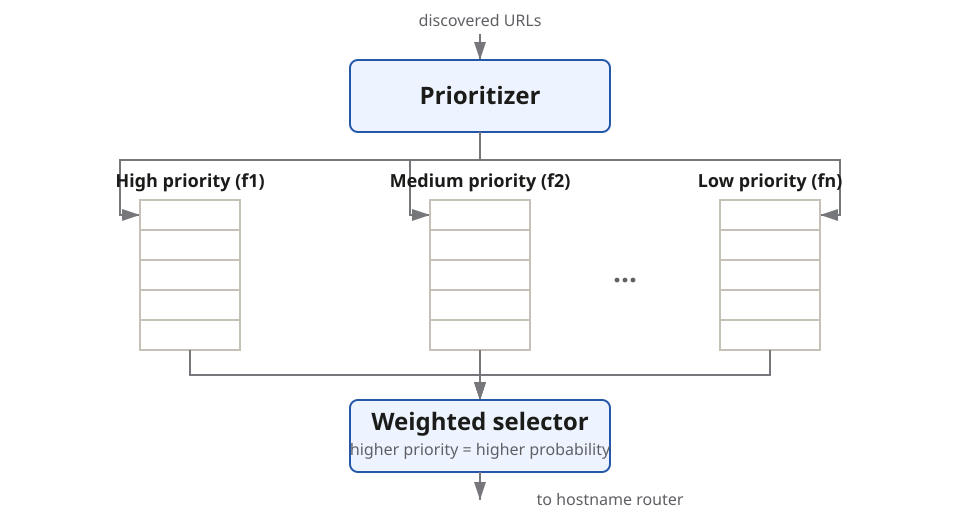
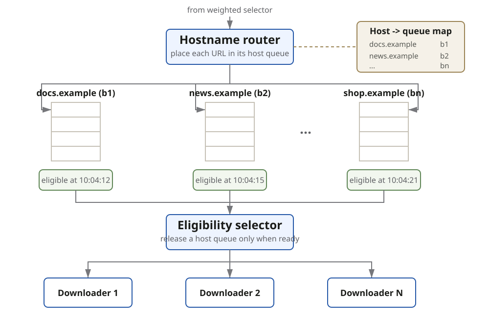

The URL Frontier holds discovered URLs waiting to be downloaded. A single FIFO
queue preserves discovery order but does not provide **priority** or **host-level
politeness**.

The frontier therefore uses two scheduling layers:

- **Priority front queues** decide which URLs should move forward.
- **Politeness back queues** decide when each host may be contacted.

## Priority front queues

- The prioritizer scores URLs using signals such as PageRank or site traffic and
  routes each URL to a front queue.
- The weighted selector chooses higher-priority queues more often without
  permanently starving lower-priority work.

## Politeness back queues

- The hostname router uses a host-to-queue mapping so **each back queue contains
  URLs for one host**.
- Each queue tracks when its host may be contacted again. The selector releases
  only eligible queues, preventing concurrent or overly frequent requests to one
  host.
- Downloader workers fetch only the URLs released by the selector.

## Storage

Large frontiers do not fit safely in memory, while a disk-only queue can make every
enqueue and dequeue expensive. A **hybrid frontier** keeps the durable bulk of
queued URLs **on disk** and uses **bounded in-memory buffers** for active enqueue
and dequeue work.

Persist enough frontier state to resume after a worker or process failure without
silently losing the queued crawl.
