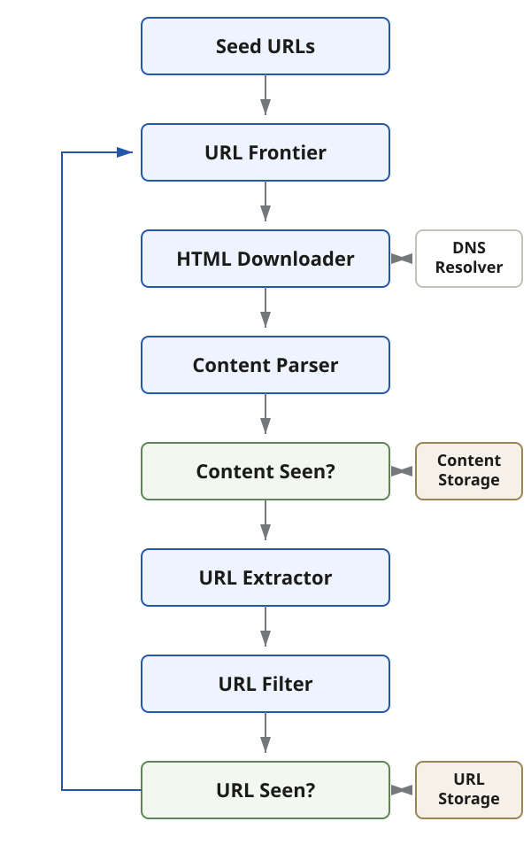

A web crawler starts from known URLs, downloads their content, extracts links, and
feeds newly discovered URLs back into the crawl.

## Common purposes

- **Search engine indexing** - the most common purpose; discover content for a
  searchable index.
- **Web archiving** - preserve copies of web content for future access.
- **Web mining** - collect content for analysis and knowledge discovery.
- **Web monitoring** - watch the web for changes, misuse, or other conditions of
  interest.

## Questions worth asking

- What is the crawler's main purpose?
- How many pages should it crawl per month?
- Is it limited to HTML, or should it collect images, PDFs, and other content?
- Should downloaded HTML be stored? If so, for how long?
- Should pages with duplicate content be stored, linked to one canonical copy, or
  ignored?

## High-level flow

### Seed URLs

Seed URLs start the crawl. They may be selected by **locality**, such as country or
domain, by **topic**, or through another partition of the target URL space.

### URL Frontier

The URL Frontier stores discovered URLs waiting to be downloaded. A scalable
frontier must account for both **URL priority** and **politeness toward each host**.

### Content Parser

The parser **validates downloaded pages** and extracts a usable representation
before the content moves through storage and link extraction.

### Content Seen?

`Content Seen?` determines whether equivalent content has already been processed.
Comparing **fingerprints or hashes** avoids repeatedly storing and processing the
same content when it appears under different URLs.

### URL Extractor

The extractor reads links from a parsed HTML page and **resolves relative paths to
absolute URLs** using that page's base URL.

### URL Filter

The filter removes malformed URLs, unsupported content types and file extensions,
blacklisted locations, and URLs outside the crawl's scope.

### URL Seen?

`URL Seen?` checks whether a URL was **already visited or is already waiting in the
frontier**. Avoiding duplicate scheduling reduces source-server load and prevents
simple link cycles.

**Deduplication does not stop a spider trap** that keeps generating unique URLs.
Crawl limits and targeted filters are still needed for effectively infinite URL
spaces.

### URL Storage

URL Storage keeps the **durable history of visited URLs** used by the `URL Seen?`
membership check.

## DFS versus BFS

The web can be modeled as a directed graph of pages connected by links. DFS is
**generally unsuitable for a broad web crawler** because the graph can be extremely
deep. **BFS is the usual starting point**, although a plain FIFO traversal has two
important limitations:

1. Many links on a page point back to the same host. Parallel FIFO workers can
   therefore **flood that host with requests**.
2. Pages do not have equal value. The crawler may need to **prioritize URLs** using
   signals such as PageRank, site traffic, or another measure of usefulness.

The URL Frontier adapts BFS to handle these scheduling concerns.
